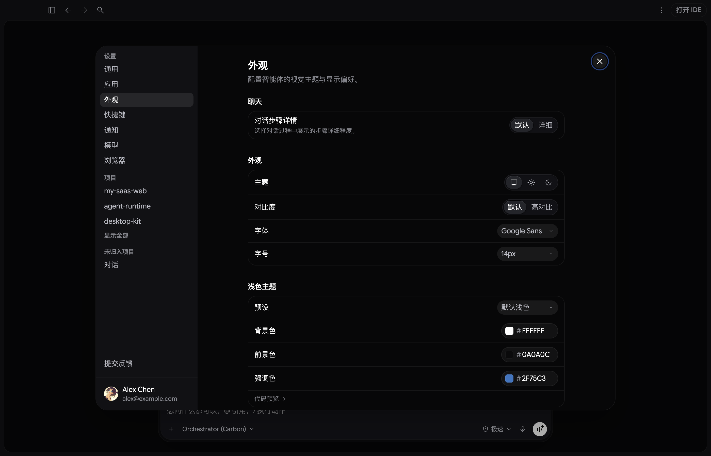
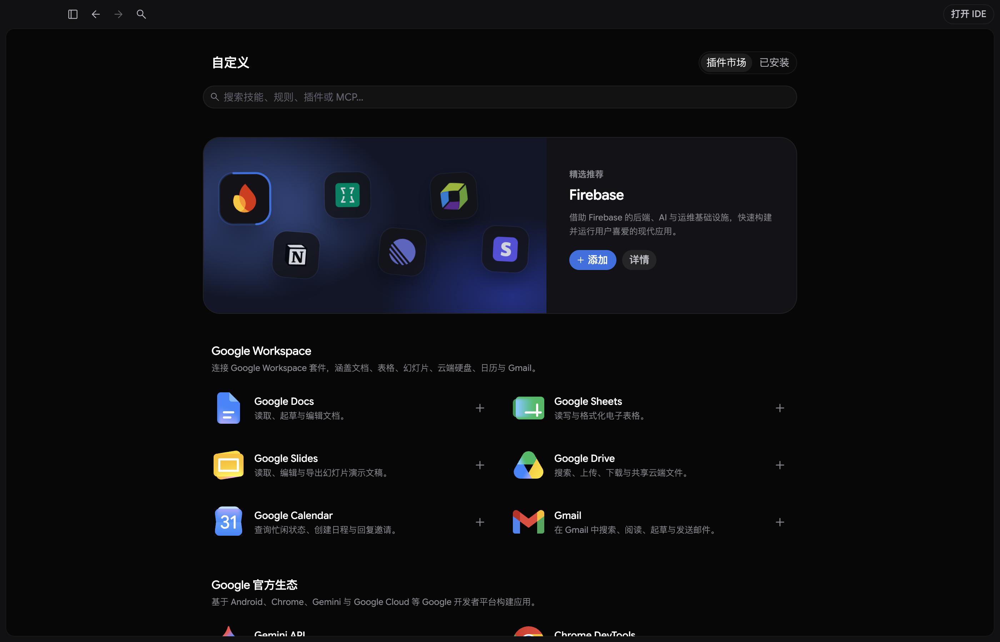

[简体中文](README.md) · [English](README.en.md) · [日本語](README.ja.md) · [한국어](README.ko.md) · [繁體中文](README.zh-TW.md)

# Antigravity Non-Intrusive Multilingual Launcher

> **Platforms**: macOS & Windows (native system scripts, **zero Node.js runtime dependency**)  
> **Coverage**: Main workbench, Settings panel, MCP & Plugin Marketplace, Skills & Rules, Agents & Automations, Hover Tooltips, Onboarding dialog + **AI Thinking & Response Localization**  
> **Languages**: 9 languages (`zh-CN`, `zh-TW`, `ja`, `ko`, `es`, `fr`, `de`, `ru`, `pt-BR`)

Localize Google Antigravity **without** unpacking `app.asar`, modifying binaries, or breaking macOS code signatures. Creates a dedicated localized shortcut icon alongside your untouched original English `Antigravity` app, surviving every official auto-update cleanly.

> 💡 **Companion Tool**: Running **Antigravity, Codex, or Claude Code** across multiple sessions? Monitor live progress, approve tool calls from your phone via QR code, and manage agents in a 3D dashboard with **[RemoDeck](https://github.com/guuguo/remodeck)** ([more tools at hub.guuguo.top](https://hub.guuguo.top)).

---

## ⚡ Why a Non-Intrusive Launcher vs. `app.asar` Patchers?

| Dimension | Traditional `app.asar` Patchers | `antigravity-zh-launcher` (This Repo) |
| :--- | :--- | :--- |
| **Code Signature & Safety** | Rewrites `app.asar`; requires ad-hoc re-signing on macOS and risks Gatekeeper blocks | **Zero modification to app files**; preserves official Google signature |
| **Official Auto-Updates** | Wiped out on every Antigravity update; requires re-patching | **Update-proof**; external launcher keeps working across updates |
| **Chat & Code Integrity** | Global substring matching **accidentally translates English words inside chat bubbles & code** | **Strict DOM boundary isolation**; never touches user prompts, code blocks, editor, or AI prose |
| **AI Thinking & Replies** | Translates UI buttons only; AI thinking & artifacts still drift back to English | **Paired AI Prompt Plugin** keeps UI, thinking steps, tool summaries, and answers in your target language |
| **Dual-Entry Coexistence** | Overwrites the single installation; requires uninstalling to check English UI | **Side-by-side icons**; keep original English `Antigravity` and localized launcher together |
| **Runtime Dependencies** | Typically requires Node.js installed locally; 1–2 languages only | **Zero Node.js runtime**; supports **9 languages** out of the box |

---

## 📸 Real Screenshots (UI + Localized AI Thinking)

| 日本語 (`ja`) | 한국어 (`ko`) |
| --- | --- |
|  |  |

| 简体中文 (`zh-CN`) | 繁體中文 (`zh-TW`) |
| --- | --- |
|  |  |

<details>
<summary>🌍 Expand More Screenshots (Settings / MCP Marketplace / Dual Icons / Español / Français / Deutsch / Русский / Português)</summary>

| Español (`es`) | Français (`fr`) |
| --- | --- |
|  |  |

| Deutsch (`de`) | Русский (`ru`) |
| --- | --- |
|  |  |

| Português (`pt-BR`) | Side-by-Side Dual Icons |
| --- | --- |
|  |  |

| Settings Panel Coverage | Customizations & MCP Marketplace |
| --- | --- |
|  |  |

</details>

---

## 🚀 One-Line Quick Install

Install [Google Antigravity](https://antigravity.google) first. No Node.js required.

### Install with Your Target Language (e.g. `ja`, `ko`, `es`, `zh-CN`)

**macOS:**
```bash
# Example: Japanese (--lang ja). Omit --lang for Simplified Chinese (zh-CN).
curl -fsSL https://raw.githubusercontent.com/guuguo/antigravity-zh-launcher/main/install.sh | bash -s -- --lang ja
```

**Windows PowerShell:**
```powershell
# Example: Japanese (--lang ja). For default zh-CN: irm .../install.ps1 | iex
& ([scriptblock]::Create((irm https://raw.githubusercontent.com/guuguo/antigravity-zh-launcher/main/install.ps1))) --lang ja
```

| Code (`--lang`) | Language | App Shortcut Name | CLI Alias |
| :--- | :--- | :--- | :--- |
| `zh-CN` | 简体中文 (Default) | `Antigravity 中文` | `agy-zh` |
| `zh-TW` | 繁體中文 | `Antigravity 繁體中文` | `agy-zh-tw` |
| `ja` | 日本語 | `Antigravity 日本語` | `agy-ja` |
| `ko` | 한국어 | `Antigravity 한국어` | `agy-ko` |
| `es` | Español | `Antigravity Español` | `agy-es` |
| `fr` | Français | `Antigravity Français` | `agy-fr` |
| `de` | Deutsch | `Antigravity Deutsch` | `agy-de` |
| `ru` | Русский | `Antigravity Русский` | `agy-ru` |
| `pt-BR` | Português (Brasil) | `Antigravity Português` | `agy-pt-br` |

---

## 🛠️ Usage & Clean Uninstall

- **Launch localized mode**: Click the generated shortcut (`Antigravity 日本語`, `Antigravity 한국어`, `Antigravity 中文`, etc.) or run `agy-ja start`.
- **Switch back to original English**: Quit the localized session and open the original `Antigravity` icon—the prompt plugin turns off automatically.

```bash
# Clean uninstall for a specific language (other installed languages stay intact)
curl -fsSL https://raw.githubusercontent.com/guuguo/antigravity-zh-launcher/main/uninstall.sh | bash -s -- --lang ja --purge
```

```powershell
& ([scriptblock]::Create((irm https://raw.githubusercontent.com/guuguo/antigravity-zh-launcher/main/uninstall.ps1))) --lang ja --purge
```

Flags: `--no-shortcut` · `--update-engine` · `--dry-run` · `--help` (Windows also accepts `-Lang`, `-NoShortcut`, `-UpdateEngine`, `-DryRun`).

---

## 🧪 Tests

```bash
python3 tests/test_launcher.py
node tests/overlay.test.js
# Windows PowerShell: & .\tests\powershell.test.ps1
```

## 🔗 Companion Tools

- **[RemoDeck](https://github.com/guuguo/remodeck)** — Self-hosted desktop & mobile remote control console for **Antigravity, Codex, Claude Code, and Grok**, featuring 5s QR mobile approvals, multi-account quotas, and a 3D Dream Factory view.
- **[hub.guuguo.top](https://hub.guuguo.top)** — Indie developer tools hub by guuguo.

---

[Website](https://hub.guuguo.top/antigravity-zh) · [MIT License](LICENSE) · [Upstream Chinese Dictionary](https://github.com/yuexps/Antigravity-Hans) · [CLI Reference](docs/usage.en.md)
