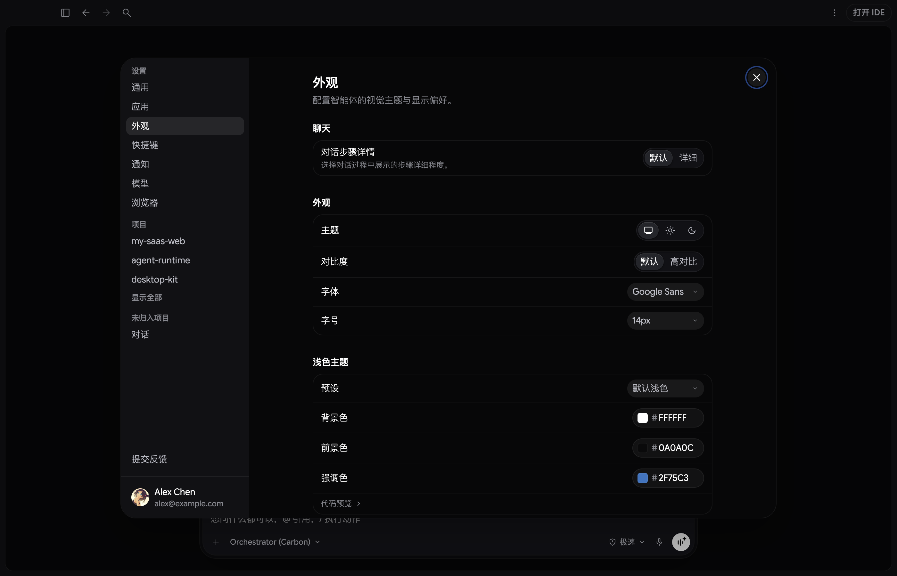
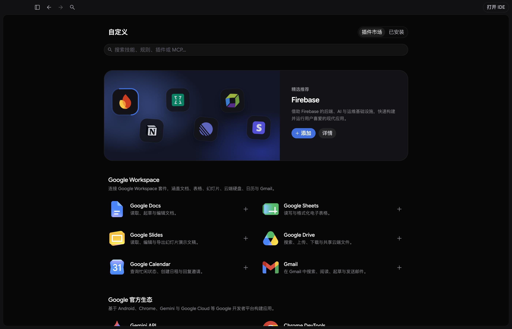
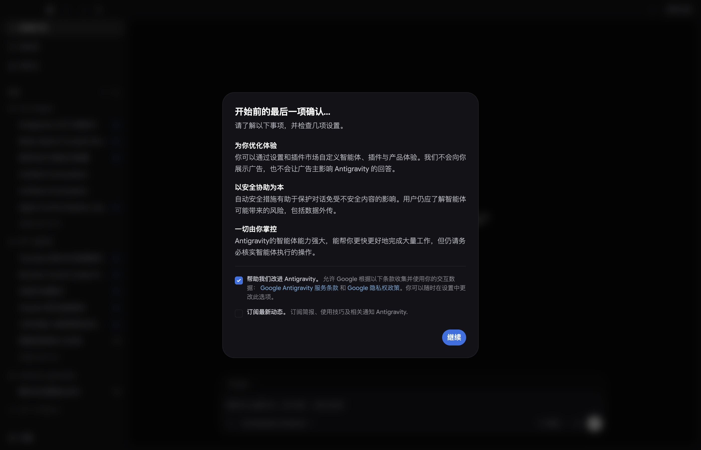

[简体中文](README.md) · [English](README.en.md) · [日本語](README.ja.md) · [한국어](README.ko.md) · [繁體中文](README.zh-TW.md)

# Antigravity 多语言无损启动器 (`antigravity-zh-launcher`)

> **适用系统**：macOS & Windows（内置系统原生脚本，**零 Node.js 运行时依赖**）  
> **覆盖范围**：软件主界面、设置面板、MCP / 插件市场、Skills & Rules、Agents / 自动化、悬浮提示 (Tooltip)、首次协议引导页 + **AI 思考过程与回答全链路本地化**  
> **支持语言**：9 国语言（简体中文 / 繁體中文 / 日本語 / 한국어 / Español / Français / Deutsch / Русский / Português）

不解包、不改写 `app.asar`、不重签名破坏官方安装包。为你生成一个独立的「**Antigravity 中文**」（或任意目标语言）启动图标，与原版英文 `Antigravity` 双图标并存、随时切换，官方每次自动升级都不失效。

---

## ⚡ 为什么选择「无损启动器」而不是传统 `app.asar` 汉化补丁？

| 对比维度 | 传统改包方案（解包重写 `app.asar`） | 本项目 `antigravity-zh-launcher` |
| :--- | :--- | :--- |
| **原版安全性与签名** | 改写官方包体，macOS 需强制重签名，易触发 Gatekeeper 损坏拦截 | **100% 零修改原版文件**，保留 Google 官方代码签名 |
| **应对官方版本更新** | Antigravity 每次升级都会覆盖 `app.asar`，必须重新打补丁 | **升级零冲突**，外挂启动器自动生效，无需重复折腾 |
| **聊天与代码防误伤** | 全局子串/短词替换，**容易把对话气泡和代码里的英文误翻成中文** | **严格 DOM 边界隔离**，跳过用户消息、代码块、编辑器与回复正文 |
| **AI 思考与输出语言** | 只汉化按钮菜单，AI 思考过程、计划书和回答仍经常飘回英文 | **联动全局语言规则插件**，界面 + 思考链路 + 终端摘要 + 回答统一语言 |
| **原版英文对照需求** | 单包覆盖，想看英文原词必须先卸载还原再重启 | **原版与本地化双图标独立并存**，随时切回原版英文 |
| **多语言与运行依赖** | 通常需先安装 Node.js 环境，仅支持中繁 | **零 Node.js 依赖**（macOS Bash+Python / Win 原生 PowerShell），支持 **9 国语言** |

---

## 📸 实机效果展示

### 1. 主工作台 + AI 思考与工具链路全中文


### 2. 设置面板（外观 / 执行 / 权限 / 快捷键 / 模型额度）深度汉化


### 3. 自定义面板（插件市场 / MCP 服务器 / Skills & Rules / 智能体）


### 4. 首次启动引导协议页 & 原版双图标独立并存
| 首次启动协议与设置引导 | 原版与本地化双图标并存 |
| --- | --- |
|  |  |

<details>
<summary>🌍 点击展开其余 8 国语言实机截图（繁體中文 / 日本語 / 한국어 / Español / Français / Deutsch / Русский / Português）</summary>

| 日本語 (`ja`) | 한국어 (`ko`) |
| --- | --- |
|  |  |

| 繁體中文 (`zh-TW`) | Español (`es`) |
| --- | --- |
|  |  |

| Français (`fr`) | Deutsch (`de`) |
| --- | --- |
|  |  |

| Русский (`ru`) | Português (`pt-BR`) |
| --- | --- |
|  |  |

</details>

---

## 🚀 一行命令极速安装

安装前请先安装官方 [Google Antigravity](https://antigravity.google)。无需安装 Node.js。

### 默认安装（简体中文 `Antigravity 中文`）

**macOS（终端运行）：**
```bash
curl -fsSL https://raw.githubusercontent.com/guuguo/antigravity-zh-launcher/main/install.sh | bash
```

**Windows（PowerShell 运行）：**
```powershell
irm https://raw.githubusercontent.com/guuguo/antigravity-zh-launcher/main/install.ps1 | iex
```

### 安装其他语言入口（以日语 `ja` 为例，9 国语言可同时并存）

**macOS：**
```bash
curl -fsSL https://raw.githubusercontent.com/guuguo/antigravity-zh-launcher/main/install.sh | bash -s -- --lang ja
```

**Windows PowerShell：**
```powershell
& ([scriptblock]::Create((irm https://raw.githubusercontent.com/guuguo/antigravity-zh-launcher/main/install.ps1))) --lang ja
```

| 语言代码 (`--lang`) | 语言名称 | 生成的桌面/启动台入口 | 命令行别名 |
| :--- | :--- | :--- | :--- |
| `zh-CN` | 简体中文（默认） | `Antigravity 中文` | `agy-zh` |
| `zh-TW` | 繁體中文 | `Antigravity 繁體中文` | `agy-zh-tw` |
| `ja` | 日本語 | `Antigravity 日本語` | `agy-ja` |
| `ko` | 한국어 | `Antigravity 한국어` | `agy-ko` |
| `es` | Español | `Antigravity Español` | `agy-es` |
| `fr` | Français | `Antigravity Français` | `agy-fr` |
| `de` | Deutsch | `Antigravity Deutsch` | `agy-de` |
| `ru` | Русский | `Antigravity Русский` | `agy-ru` |
| `pt-BR` | Português (Brasil) | `Antigravity Português` | `agy-pt-br` |

---

## 🛠️ 日常使用、更新与无痕卸载

- **日常启动**：直接从 macOS「应用程序 / 启动台」或 Windows「桌面 / 开始菜单」点击 **`Antigravity 中文`**（或对应语言图标）即可。
- **切回纯正英文原版**：退出当前会话后，直接点击原本的 **`Antigravity`** 图标——注入器与中文 Prompt 规则会自动关闭，100% 原生英文体验。
- **刷新最新词库**：重新运行上面的安装命令，或执行 `agy-zh build-overlay --force`。

**常用 CLI 命令：**
```bash
agy-zh status                # 查看当前本地化状态与进程信息
agy-zh prompt on|off|status  # 单独开关或查看 AI 语言规则插件
agy-zh build-overlay --force # 强制重新构建最新覆盖词库脚本
```

**一键干净卸载：**
```bash
# macOS（卸载简体中文并清理缓存；其他已安装语言不受影响）
curl -fsSL https://raw.githubusercontent.com/guuguo/antigravity-zh-launcher/main/uninstall.sh | bash -s -- --lang zh-CN --purge
```
```powershell
# Windows PowerShell
& ([scriptblock]::Create((irm https://raw.githubusercontent.com/guuguo/antigravity-zh-launcher/main/uninstall.ps1))) --lang zh-CN --purge
```

本地仓库安装/卸载同样支持：`bash install.sh --lang zh-CN`、`bash uninstall.sh --lang zh-CN --purge`（附加参数：`--no-shortcut`、`--update-engine`、`--dry-run`、`--help`；Windows 亦兼容 `-Lang`、`-NoShortcut`、`-UpdateEngine`、`-DryRun`）。

---

## 🔍 工作原理与技术边界说明

1. **零二进制入侵**：通过本地回环（`127.0.0.1`）CDP 协议在窗口加载时动态挂载渲染层翻译字典（590+ 精确词条 + 20 组动态正则模板 + `Intl.RelativeTimeFormat` 相对时间与欢迎语模板），退出即释放，不改动 `Antigravity.app` / 安装目录内任何字节。
2. **绝不污染对话与代码**：运行时自动跳过 `.monaco-editor`、`.xterm`、`<code>`、`<pre>`、用户提问气泡与 AI 回复正文，只翻译 UI 控件、设置项、面板说明与悬浮提示，解决传统汉化包“把聊天里的英文单词也硬翻成中文”的痛点。
3. **原生系统顶栏边界（路线取舍）**：因坚持不解包修改 Electron 主进程 `app.asar`，macOS 屏幕最顶部的系统原生菜单栏（`File / Edit / View`）保持系统原样，以此换取官方代码签名完整与升级零损坏。

---

## 🧪 本地验证测试

```bash
python3 tests/test_launcher.py
node tests/overlay.test.js
# Windows PowerShell: & .\tests\powershell.test.ps1
```

[官网介绍页](https://hub.guuguo.top/antigravity-zh) · [MIT License](LICENSE) · [基础中文词库致谢](https://github.com/yuexps/Antigravity-Hans) · [CLI 详细说明](docs/usage.en.md)
